# Time Zone +13:00 (Eufrosyne, Juhla IVb 1997) - effects, art and timing

*Time Zone +13:00* by **Eufrosyne** (code and design suckho, graphics and end music duke, music dune/orange; `HALKOJA.NFO`), released at Juhla IVb, Raahe, 7-9.3.1997.
The NFO says the whole demo "except voxel routine" was made in two weeks and that it targets a 120 MHz Pentium. `TZ1300.EXE` is an MZ stub + PMODE/W 1.32 + an
uncompressed LE image (Watcom C + hand-written asm, MIDAS Sound System 0.5.0), the music is two Scream Tracker modules (`AUMAX.S3M`, then `PILIPS.S3M` for the ending) and all art is in one
container, `TZ1300.DAT`. Duration 256.7 s, 9 scenes. Everything below was read from the disassembly (`re/obj1.bin`, `re/dis.sh`) and checked against the JavaScript port in `web/fx/`;
"bit-exact" always means "0 differing pixels against the Unicorn oracle over the frames the oracle recorded" (section 7 says what that does and does not cover).
The companion file `WRITEUP-asm.md` has the disassembly excerpts.

Figures are in `figures/` (`node tools/make_figures.mjs && python3 -I tools/make_figures.py` rebuilds them from the port; the screenshots are the port at the times given in the captions).

## 0. At a glance

* **VGA mode 13h, 320x200, 256 colours**, pixels not square: shown 4:3. Every effect renders into a 64000-byte buffer (`0x337210`) or straight into `0xA0000` and the **palette is rewritten every timer tick**.
* **Animation is a function of the timer tick `n`, not of the music.** MIDAS reprograms the PIT (reload 16951 = **70.39 Hz**) and the timer callback increments `n` (`[0x231f88]`); effects read it once or twice per frame.
  The music only decides *when a scene ends* (S3M order/row polled by the same callback) and when the fade/flash events fire.
* **Draw as fast as you can**: there is no frame limiter. The frame rate depends on the machine (about 12 fps for the 3D scenes on the 50 MIPS model of the harness), which matters for the scenes that integrate state per frame (4, 5, 6, ending).
* One **shared 3D engine** (section 3) draws scenes 1, 2, 3, 4, 5 and 7: integer fixed point, 4096-entry sine table, flat-shaded triangles, additive sprites, a 1-bit radix sort of the render list.
  Scenes 4 and 6 add a texture-mapped "voxel" landscape painter, scene 2 a polar-mapped landscape, scene 0 and 8 are pure 2D.
* **No MMX/FPU in the effect loops** (no x87/MMX mnemonic in the effect code `0x100000..0x10e000` of the listing): floating point is used only at start-up (sin/cos tables, atan2/sqrt tables, landscape tables) through Watcom's runtime.
* A single **global fade/flash level** added to every palette entry drives all fade-ins, fade-outs and beat flashes (section 2).

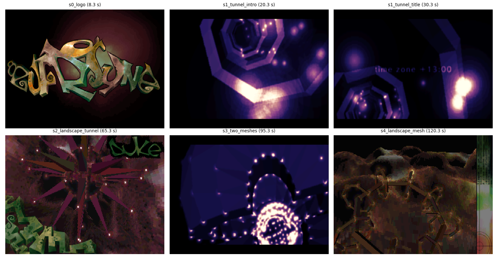
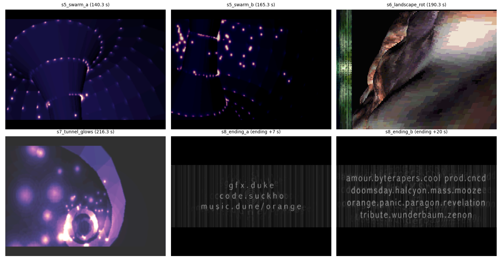

## 1. Timeline

AUMAX: speed 6 / tempo 144 and never changes, so 1 row = 0.10417 s, 1 order = 64 rows = 6.667 s, 233.3 s in all (the S3M references patterns that do not exist; they play as 64 empty rows).
Each scene function loops until the S3M position `(order [0x231f84], row [0x231f7c])`, polled by `0x100340`, reaches its end values; the seconds are `order*6.667 + row*0.10417`
(`web/timetable.js`, `re/s3mtime.py`).

| # | function | starts at (order,row) | seconds | content | state in the port |
|---|---|---|---|---|---|
| 0 | `0x109760` | 0,0 (black until the fade-in at 0,58) | 0 | Eufrosyne logo (DAT image 7) | exact |
| 1 | `0x102b90` | 2,12 | 14.58 | octagonal tunnel + 64 glow particles, title "time zone +13:00" from order 4 | exact per tick |
| 2 | `0x107e10` | 8,0 | 53.33 | polar landscape tunnel + star mesh + overlay + 3 credit strips | exact per tick pair |
| 3 | `0x1029b0` | 12,0 | 80.00 | big shell mesh + point sphere, swinging camera | exact per tick |
| 4 | `0x108250` | 16,0 | 106.67 | landscape fly-over + mesh + overlay | exact given the history |
| 5 | `0x102650` | 20,0 | 133.33 | 192-point swarm around an attractor, mesh in the middle | exact given the step counts |
| 6 | `0x108530` | 26,0 | 173.33 | landscape fly-over rotated 90 degrees + overlay | exact given the history |
| 7 | `0x102e90` | 30,32 | 203.33 | second tunnel mesh + 64 glows | exact per tick |
| 8 | `0x1097f0` | PILIPS 0,0 | 228.33 | ending: two credit images cross-faded + noise streaks | exact given the history |
| - | end | PILIPS 4,16 | 256.67 | | |

(Scene numbers are the port's `web/fx/fxNN.js`. Scene 7 ends at AUMAX (34,16) = 228.33 s: the original then stops AUMAX, loads PILIPS and runs the ending for 28.33 s.)

Frame cost seen in the Unicorn harness (20 ns per instruction, about a 50 MIPS machine; the harness clock runs at 70.4 ticks/s): scene 1 6.8 ticks/frame, 2 6.0, 3 7.7, 4 5.5, 5 6.4, 6 2.3, 7 6.5, ending 2.7.
`README.md` explains why the player uses K = 2, 2, 1, 1 ticks per frame for scenes 4, 5, 6 and the ending.

**Music/clock caveat.** With no sound card MIDAS steps the module once per timer tick assuming exactly 70 Hz, so the harness music runs 70.39/70 = 0.56 % fast against the nominal tempo and the
oracle's "tick n" is `70 t + 8.75`. The player uses nominal music time and `n = 7 + 70.39 t`; the offset is arbitrary (it is the load time on a real machine).

## 2. The fade / flash state machine (timer callback `0x100370`)

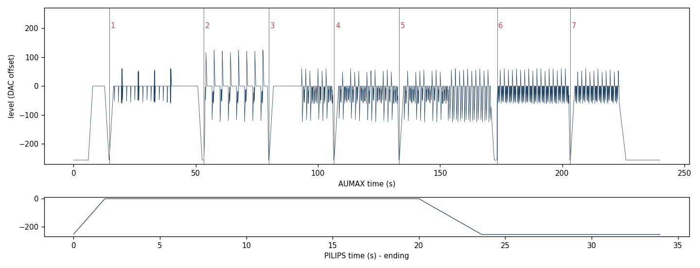

The timer interrupt calls `0x100370` on every tick (70.39 Hz): `n++`, poll the S3M position, then run a small state machine on a command `cmd` (`[0x231f70]`) and a **level** (`[0x231f74]`, -256..0, 0 = no change).
The same tick uploads the palette (`0x100a00`): `DAC[i] = clamp(pal[i] + level, 0, 255) >> 2` on all three channels. One scalar added to every channel means a negative level fades towards black and a positive level
flashes towards white, with the same code.

| cmd | per tick | used for |
|---|---|---|
| 0 | level moves 4 towards 0 | hold, and the decay of a beat flash |
| 1 | +2 until above 0, then level 0 and cmd 0 | fade in from black (128 ticks = 1.8 s) |
| 2 | -2 down to -256 | slow fade out |
| 3 | -8 down to -256 | fast fade out (0.45 s) |
| 4 | -1 down to -256 | very slow fade out (final) |
| 5 | +1 up to 0 | implemented, no event uses it |

Events fire once when `(order,row)` changes to a listed value (`reset` = level forced to -256 first). AUMAX: (0,58) in+reset; (1,58) cmd 2; (2,12) in+reset; (7,40) cmd 2; (8,0) cmd 0; (11,58) cmd 3;
(12,0) in+reset; (15,58) cmd 3; (16,0) in+reset; (19,58) cmd 3; (20,0) in+reset; (25,40) cmd 2; (26,0) cmd 0+reset; (30,26) cmd 3; (30,32) in+reset; (33,32) cmd 4. PILIPS: (0,0) in+reset; (3,0) cmd 4.
So the logo is shown black until 6.04 s, scenes 2..7 each start from black with a fade in, and scene 2 comes back from the black left by the slow fade of (7,40) through cmd 0 at (8,0) (+4/tick, 0.9 s); scene 6 does the same at (26,0).

**`W` sync commands.** 416 S3M `W` effects in AUMAX (info 0x10..0x14) call the MIDAS sync callback `0x100910` from the player: **only when cmd = 0**, info 0x10 sets the level to +0x80, 0x11 to -0x80, 0x12 to +0x40,
0x13 to -0x40 (0x14 is ignored). The decay of cmd 0 (4/tick) then turns each of them into a 0.2-0.45 s flash to white or dip to black on the beat. That is the pulsing you see in the tunnel scenes.

Port: `web/fx/fade.js` runs the same machine on a tick grid (`web/fx/sync.js` = the 416 W commands, extracted by `re/mk_sync.py`). **Approximated**: the W flash lands about 0.5 tick before the row boundary the events use
(fitted constant `SYNC_LEAD`), and the tick phase is fitted. Over the whole Unicorn run (`tools/fxcheck_fade.mjs`): AUMAX 11157 of 15994 timer records exact, 4577 within one tick (4 DAC units), 260 worse;
PILIPS 1603 / 262 / 126 of 1991. The "worse" ones are flash edges one tick off and the first ~60 ticks of the ending.

## 3. The shared 3D engine (`web/fx/engine3d.js`)

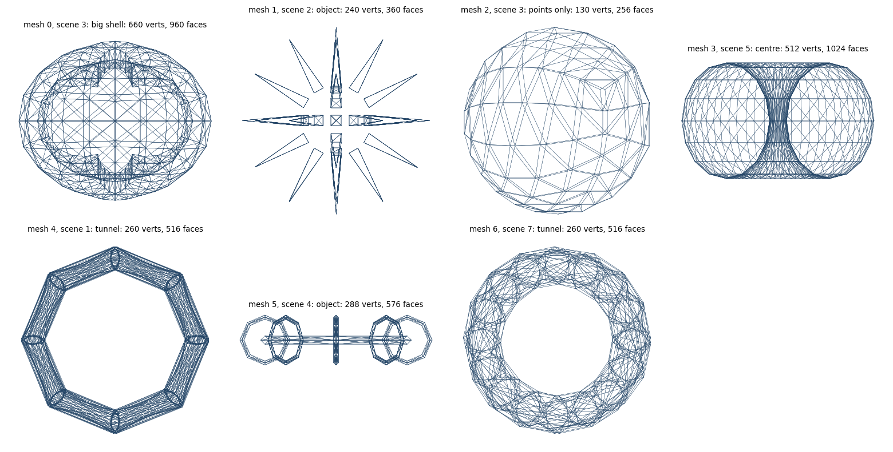

**Tables.** `sin`/`cos` are 4096 entries of `int(sin(a) * 32768)` (truncated), `a += 0.001533980788085938` (= 3.141592654 / 2048, the author's pi; `0x102570`, tables at `0x333210` and `0x300110`).
Every angle is an index `& 0xfff`; the animations are linear combinations such as `sin[5n]`, `sin[9n]`, so each scene is a Lissajous of the tick. `Math.sin`/`Math.cos` reproduce the integer tables exactly (`tools/checksin.mjs`).

**Objects.** A scene is a table `count, camera{x,y,z,rx,ry,rz}, objects[]` with 32-byte objects (x,y,z, rx,ry,rz, scale, mesh byte at +0x1c, type byte at +0x1e). `0x1024a0` walks it and dispatches on the type:

| type | object | emits |
|---|---|---|
| 4 | point | 16x16 additive spot (sprite sampled every 8th texel, `src*8`) |
| 9 | point | 16x16 spot, `src*2 - size`, size grows with distance |
| 5 | point | scaled 128x128 additive glow, size `0x100 - d/64 + 0x20` clamped 0x10..0xff |
| 14 | point | same glow, size from `d/128` (the attractor of scene 5) |
| 1, 3 | mesh | flat triangles `>>17`, no depth cue (3 also emits a spot per visible vertex, `src*8`) |
| 2 | mesh | only the spot per visible vertex |
| 6, 8 | mesh | flat triangles `>>17` with depth cue (8 also emits a type-7 spot per vertex) |
| 10, 11 | mesh | triangles `>>16` + 0x28 bias, depth cue |
| 12, 13 | mesh | triangles `>>16`, depth cue |

**Transform.** Mesh (`0x100ae0`): build the object's 3x3 rotation (z, x, y), combine with the camera rotation (z, x, y) one column at a time, scale by `obj.scale >> 8`; vertex = column combination; `depth = (acc/2 + camZ<<12) >> 8`,
`screen = (acc/2 + cam<<12) / depth + (160, 100)`. Points (`0x102060`) do the same for one vertex. All matrix products are `(a*b +- c*d) >> 15` with the *truncating* signed shift (see asm section 1).
A face needs depth > 0 on all three vertices, one vertex on screen, and must be back-face culled by `(ya-yc)(xa-xb) < (xa-xc)(ya-yb)`. **Shade** = `-(camera-z row . face normal) >> 16 (or 17)` plus the bias and a depth cue
`(sum of depths - 0x40000) / 4096`, clamped to 0..0xbf. The per-face normals are *precomputed in the mesh* (arrays 13..15); mesh 6's normal-z array runs 0x80 bytes past the end of the mesh in the original, and the port includes those bytes.

**Render list.** Every triangle/spot/glow becomes a 64-byte entry at `0x235e58` (x1,y1,x2,y2,x3,y3 at +0..0x14, key +0x18, shade or size +0x1c, entry type +0x20, key = sum of vertex depths or 3d). A **32-pass binary radix sort**
(`0x107a78`) sorts the key ascending, the draw loop walks it far to near (painter's algorithm).

**Rasterisers.** Flat triangle `0x1036ff` (fast path when every vertex is inside, else per-pixel clip), glow `0x107937` (scaled 128x128 sprite), spots `0x1077dc`/`0x107889` (16x16). All writes go to a 320x200 byte buffer
as `dst = min(src*k + dst, 0xbf)` for sprites (additive, saturating at 0xbf) and plain shade stores for triangles. **Palette indices stay below 0xc0 on purpose**: the top 64 entries belong to the overlays that scenes 2, 4, 6 paint with `+0xc0`.

**Post.** Scenes 1, 3, 5, 7 finish with a 4-tap blur written straight to VGA: `out[i] = (b[i-1] + b[i+1] + b[i-320] + b[i+320]) >> 2` for `i` in `0x1400..0xe5ff` (rows 16..183; the rest of the screen stays black, hence the letterbox bands).
The glow sprite (a soft round blob), the tunnel mesh and the star ramp palette (DAT image 12) are the whole visual vocabulary of these scenes.

## 4. Scenes

### Scene 0 - logo (`0x109760`, 0-14.58 s)
DAT image 7 (the Eufrosyne graffiti logo, 320x200) copied to VGA every frame; only the palette moves: black until (0,58), fade in, W flashes on the beat, fade out at (1,58), black until scene 1.
**Exact**: pixels in all 1727 oracle frames, DAC equal given the original's own fade level (`tools/fxcheck00.mjs`).

### Scene 1 - tunnel with glow particles (`0x102b90`, 14.58-53.33 s)
Object table of 65 objects: object 0 is the **tunnel mesh 4** (type 10, 260 vertices, 516 faces: an octagonal ring extruded along y, scale 1024), objects 1..64 are type-5 **glow particles**.
Per frame, with `n` read once at the start:

* camera `x = sin[5n]/128`, `z = sin[3n]/128`, **`y = -((n<<5) & 0x1fff)`** (flying down the tunnel; the wrap period 0x2000 is presumably the mesh length, there is no visible jump), rotation `rx = sin[9n]/0xc0 - 0x400`, `ry = sin[4n]/0xc0`, `rz = sin[7n]/0xc0`;
* particle k: `x = sin[11n + 0x543 k]/128`, `y = sin[9n + 0x210f k]/32 + camY - 1000`, `z = sin[6n + 0xa56 k]/128`, each one a different phase of the same three sines;
* clear the buffer, transform mesh then points, radix sort, rasterise (flat shaded triangles in the ramp palette, then the glows add up and saturate at 0xbf: the white-hot blooms);
* from AUMAX order 4 (26.7 s) the **title overlay** (DAT image 6, rows 64..136, "time zone +13:00") is added: `v = max(img - d, 0) + buf` (clamped 0xbf) with `d = sin[((n>>1) + 0x500)] / 128 + 0xd0`, so the text is subtracted by a slowly pulsing offset (`d` runs from -48 to 464) and fades in and out; the tick is read a second time at this point;
* blur as in section 3.

**Exact** for a given tick: 402 of 402 oracle frames (0..53 s) identical, DAC identical (`tools/fxcheck01.mjs`). Exactness is per tick value: the oracle only records `n` at the end of the frame, so the checker searches the `n` that reproduces each frame; each one found one.
**Approximated**: which `n` the player uses at a music time (`n = 7 + 70.39 t`) and the frame rate (the player draws at the display rate).

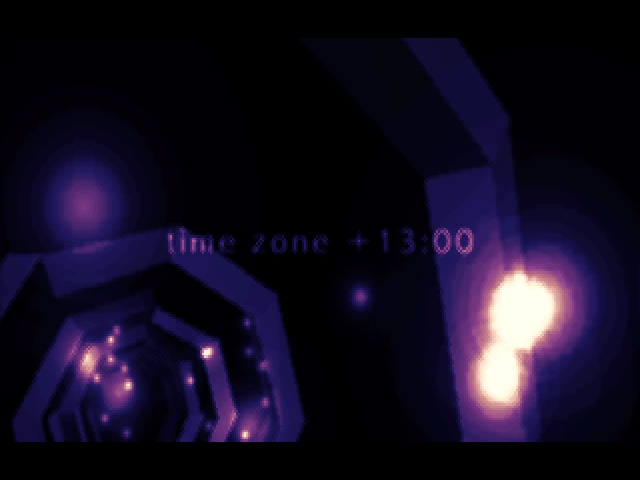

### Scene 2 - polar landscape + star mesh (`0x107e10`, 53.33-80 s)
Two 2D effects and one 3D object:

* **Polar landscape.** A 256x200 *work map* is painted column by column (one column per x, i.e. per angle): for depth slices `k = 0..0x60` the height map (DAT image 8) at `((n + k) & 255) + 256 x` gives a screen limit
  `T[k][h] = max(0, h*32/(k+1) - 10)` and the slice's texel (DAT image 11) fills the column from the bottom up to it while it is higher than anything nearer (a voxel-style column painter with occlusion). The screen is then read
  **in polar coordinates** from that map: `screen(x,y) = work[ D(x,y) << 8 | (A(x,y) + (sin[8n] >> 9)) & 255 ]`, `D = int(sqrt(x^2+y^2))`, `A = int(atan2(y,x) * 256/2pi)` from tables built at start-up (`0x107ce0`).
  A flat landscape seen from inside a tube, twisting with `sin[8n]`.
* **Star mesh**: mesh 1 (240 vertices, type 8: shaded triangles + additive points), scale 256, camera (-500, 0, -2000), rotation `6n, 7n, 5n`, position `sin[6n]/64, sin[5n]/64, sin[9n]/64`. It uses the tick read at the *end of the previous frame* (first frame: at rest).
* **Overlay** DAT image 3 (the green block letters, `+0xc0` palette) and three **credit strips** (DAT image 2, 3 x 42 rows: suckho, duke, dune) shown at (8,0x21)-(9,0x1f), (9,0x21)-(10,0x1f), (10,0x21)-(11,0x1f).

**Exact** for a given tick pair (311 of 311 frames; strips read the row one record earlier in rare frames). The table of `atan2` needed care: the original multiplies by the double `0x3fc45f306dbe5bcd` (0.15915494307111, slightly below 1/2pi) after `* 256`, which
differs from the exact `256/2pi` on 757 of the 64000 entries (exact multiples of 32 for negative angles); the port uses an equivalent constant (0 differences against the emulator's table).

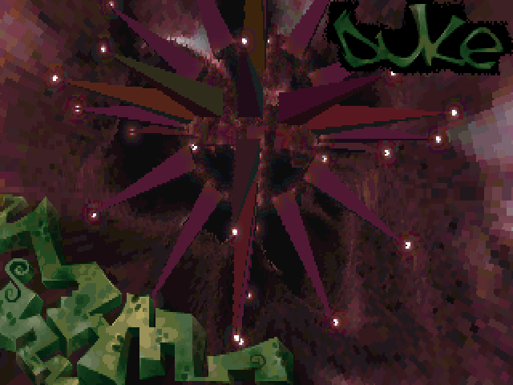

### Scene 3 - two meshes with points (`0x1029b0`, 80-106.67 s)
No particles: **mesh 0** (660 vertices, 960 faces, type 3: a big dark shell, scale 2048, `ry = 2n`) and **mesh 2** (130 vertices, type 2: only the additive spots of its vertices, rotating `4n, 5n, 3n` with a pulsing scale `sin[32n]/128 + 0x300`)
inside it; the camera swings: `x = -1024`, `y = sin[4n]/16 - 0x1800`, `rx = sin[13n + 0x800]/512`, `ry = sin[16n + 0x800]/256 + 0x400`, `rz = sin[11n + 0x800]/256 - 0x300`. Blur. A pure function of `n`: **exact**, 241 of 241 frames.

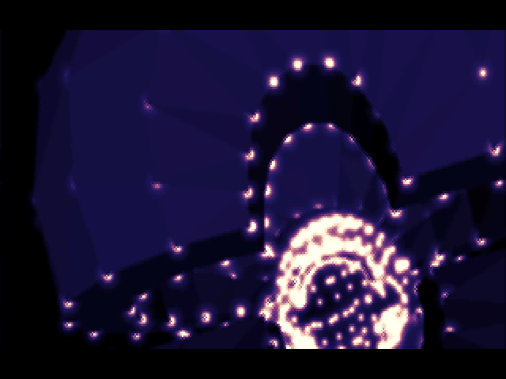

### Scene 4 - landscape fly-over with a mesh (`0x108250`, 106.67-133.33 s)
The classic **height-map landscape painter** (the "voxel routine", which the NFO excepts from the two weeks the rest took, so probably older code), `0x108d78`, texture DAT image 9, height map image 8, plus mesh 5 (288 vertices, type 8, scale 192) and the overlay DAT image 5
(the vertical bar with the crosshair on the right edge).

* The camera is not a function of `n`: each frame the heading `e = sin[4n]/128 + sin[7n]/256 + 0x280 (mod 0x500)` is computed, and the position accumulators advance `B -= 2 sin[e*4096/0x500]`, `C += 2 cos[...]`. The painter of the *next* frame gets `(e, B, C)`,
  so the flight depends on the frame cadence (factor 2 here, 1 in scene 6).
* The painter walks **145 screen columns** (each 2 px wide, `L = 0x91..1`) and for each one **128 samples** along a ray whose three increments (u step, v step, distance step) are
  `cos[2L]`, `sin[esi + 2L]`, `cos[esi + 2L]` (tables `sin/cos(0.7953981635 - i*2pi/1280) * 65536` truncated, built at `0x108100`) and **grow by half of their start value every 32 samples** (perspective). Each sample gives a texture address and a
  distance row; the height map selects a **division table** entry `(0x640 + 0x20 row) / c` = the screen row up to which this sample's texel is painted (from the bottom up, never over an already-painted pixel).
* The mesh object (updated after the render) is drawn over it with the usual engine.

**Exact** given the original's frame history (341 of 341 frames); the port replays from the scene start with K = 2 ticks per frame, which is an assumption (README, Cadence).

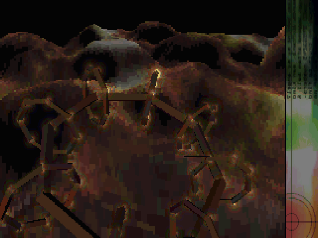

### Scene 5 - the swarm (`0x102650`, 133.33-173.33 s)
Object 0 is mesh 3 (512 vertices, type 3, scale 320: the dark "hourglass"), object 1 a **type-14 glow attractor** at `(cos[7n]/64, sin[23n]/128, sin[7n]/64)` and objects 2..193 are 192 type-4 points.
The points are a **simulation**: start positions from 5 `rand()` calls each (Watcom LCG `seed*0x41c64e6d + 0x3039`, `(seed>>16)&0x7fff`, seed 1): `x = cos[r1 & 0xfff] / ((r2 >> 10) + 0x30)`, `y = (r3 >> 5) - 0x200`, `z = sin[r4 & 0xfff] / ((r5 >> 10) + 0x30)`,
velocity 0; then **per elapsed timer tick** `v += (target - p) >> 9`, `p += v` (a spring towards the attractor, integer and truncating). The camera orbits `(-cos[4n-0x400]/32, 0, sin[4n-0x400]/32)`.
The simulation steps once per *elapsed tick* between two reads of the timer, so a slow machine takes bigger steps per frame and the positions depend on the history, not on `n` alone.

**Exact** (440 of 440 frames) when fed the original's steps per frame (`re/m5.json`, read from the original's object table by `re/dump5.py`: every consecutive pair of tables is reproduced exactly by `m` repeated steps, m = 5..9). The player's cadence is an assumption
(K = 2 ticks per frame).

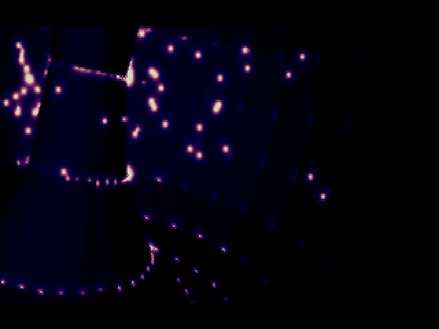

### Scene 6 - rotated landscape (`0x108530`, 173.33-203.33 s)
The same painter turned 90 degrees (`0x108ec1`: columns become horizontal 2-px bands painted right to left), texture DAT image 10, the left-edge bar of DAT image 4 as overlay, no 3D object, no blur. The heading is
`sin[2n]/64 + sin[5n]/256 + 0x280` and the step is 1 (not 2) per frame. **Exact** given the history (914 of 914 frames).

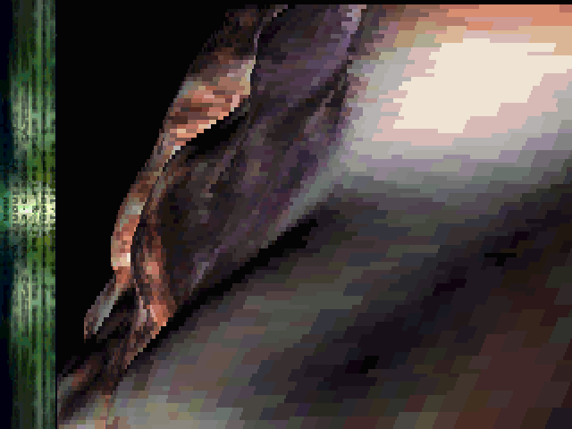

### Scene 7 - second tunnel (`0x102e90`, 203.33-228.33 s)
Scene 1's engine with other numbers: **mesh 6** (260 vertices, type 12, another tunnel mesh: a ring of overlapping tubes in the wire view) and 64 type-5 glows (`x = sin[14n + 0x543k]/128`, `y = sin[11n + 0x210fk]/32 + camY - 1000`, `z = sin[9n + 0xa56k]/128`),
camera `x = sin[9n]/0xc0`, `y = -((48n) & 0x1fff)`, `z = sin[6n]/0xc0`, `rx = sin[11n]/128 - 0x400`, `ry = sin[7n]/0xc0`, `rz = sin[9n]/0xc0`, blur. Scene 6 fades out at (30,26) (cmd 3) and this scene fades in at (30,32). A pure function of `n`: **exact**, 268 of 268 frames. The oracle found a bug that is worth knowing: mesh 6's normal arrays run past the end of the mesh, so the original reads 0x80 bytes of whatever follows.

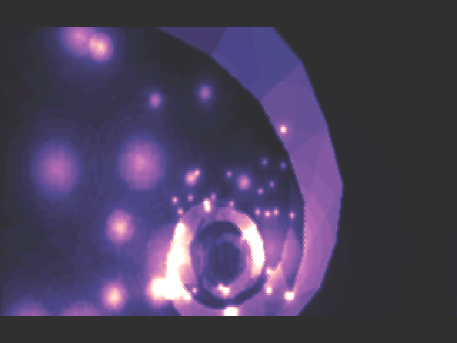

### Scene 8 - ending (`0x1097f0`, PILIPS 0-28.33 s)
Two DAT credit images (0: "gfx.duke code.suckho music.dune/orange", 1: the greetings list) in rows 48..191, cross-faded by a sine: with `e = (sin[2n + 0x100] >> 9) + 0x40`, `out = max(0, img1/2 - e) + max(0, img0/2 - (0x80 - e))`
(the two images trade brightness as `e` oscillates, each fading by *subtraction* of an offset in a shared grey ramp). On top, **noise streaks**: three `rand()` per frame seed a four-accumulator generator (asm section 12) that adds `(bx & 0x1f) + 0xc` to every pixel, giving the vertical grain.
PILIPS fades in at (0,0) and out with cmd 4 at (3,0). `n` counts ticks since the ending started and is read three times per frame (blend `0x109872`, noise `0x1098fc`, `0x109905`; ticks pass while the blend runs).
The rand state continues from scene 5, which consumed 960 calls (192 x 5) before: seed 1 is verified by the exact ending (726 of 726 frames).

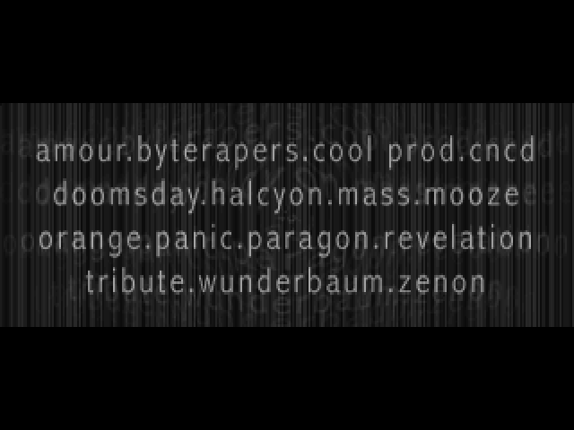

## 5. The art (TZ1300.DAT)

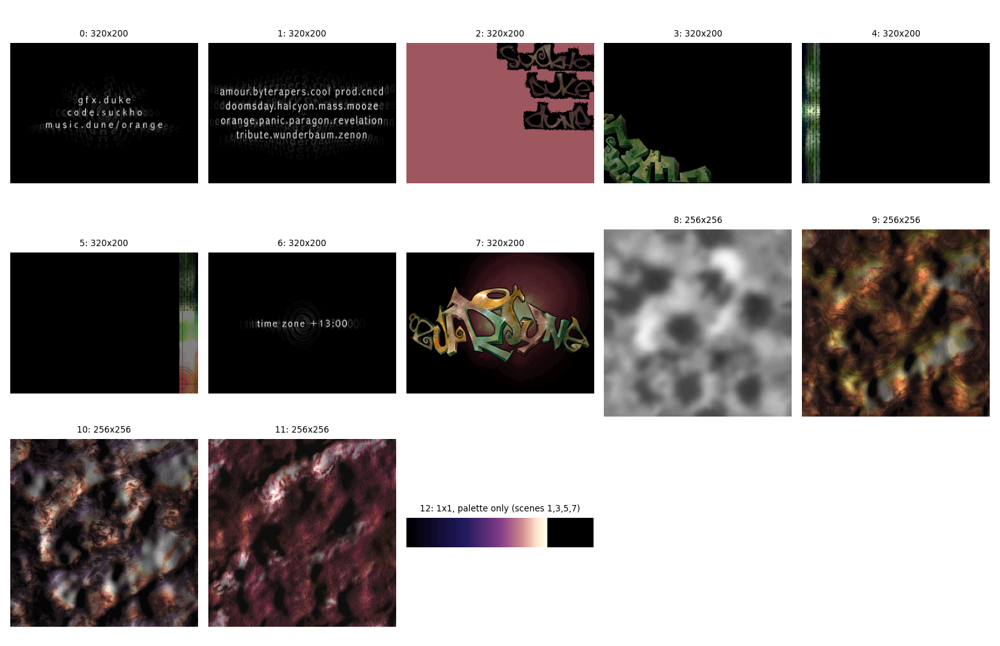

13 concatenated "mhwanh" images (32-byte big-endian header: version 4, width, height, 256; then a 768-byte palette with 8-bit values used `>>2` for the DAC; then width*height indices). The original reads slices into fixed addresses at start-up (`0x109070`; the port's `MEM` table in `web/fx/dat.js` is compared equal to the memory dump).
Palettes are *composed*: scenes 2, 4, 6 take the first 192 colours (0x240 bytes) of the texture image and the first 64 of the overlay image at index 0xc0.

| image | size | used by |
|---|---|---|
| 0, 1 | 320x200 | ending (credits, greetings) |
| 2 | 320x200 | three credit strips of scene 2 (3 x 42 rows) |
| 3 | 320x200 | scene 2 overlay (green block letters) |
| 4, 5 | 320x200 | scene 6 / scene 4 overlay (bar with a crosshair, at the left / right edge) |
| 6 | 320x200 | scene 1 title "time zone +13:00" |
| 7 | 320x200 | logo |
| 8 | 256x256 | height map of scenes 2, 4, 6 |
| 9, 10, 11 | 256x256 | landscape textures of scenes 4, 6, 2 |
| 12 | 1x1 | palette only: the purple-to-cream ramp of scenes 1, 3, 5, 7 |

The 7 meshes live in the data object (`0x203838..0x22e9b8`, pointer table `0x260de8`) and are extracted by `re/mk_assets3d.py` (`web/assets/tz13_mesh.bin`, `tz13_3d.bin`). Header `[nv, nf, byte offsets...]`: x, y, z arrays, face indices a, b, c, face normals.

## 6. Port structure

`web/player.js` (canvas 2D, 4:3, pause + seek + scene buttons, libopenmpt music with AUMAX swapped for PILIPS at 3:48), `web/timetable.js`, one `web/fx/fxNN.js` per scene (`init()`, `render(t, ctx)`), `engine3d.js`, `terrain.js` (the two painters),
`fade.js`, `dat.js`. Scenes that are pure functions of `n` seek instantly; scenes 4, 5, 6 and the ending replay their state from the scene start (fixed K), so a seek is repeatable (`tools/uitest.mjs`).

## 7. Bit-exact vs approximated (same as README)

* **Exact** (0 differing pixels against the Unicorn run of the original): logo 1727/1727; scene 1 402/402; scene 2 311/311; scene 3 241/241; scene 4 341/341; scene 5 440/440; scene 6 914/914; scene 7 268/268; ending 726/726; the palette given the fade level the original had.
* **Exact per tick, not per music time**: the checkers search, for each oracle frame, the tick(s) the original read. That the *player* shows those frames at the right *music time* is the fitted part.
* **Approximated**: (1) the fade/flash level over time (`fade.js`, sections 2 and 7 of README: 98 % of timer records within one tick); (2) the mapping music time -> tick (`n = 7 + 70.39 t`, arbitrary offset);
  (3) the frame cadence of scenes 4, 5, 6 and the ending (K = 2, 2, 1, 1 ticks per frame, an assumption about a 1997 Pentium), which changes the exact landscape position and the exact particle positions you see, not the look;
  (4) the original's frame rate for scenes 1, 2, 3, 7 (the player draws at the display refresh).
* Scene boundaries are the exact `(order,row)` the original waits for, converted to seconds with the constant S3M tempo.
